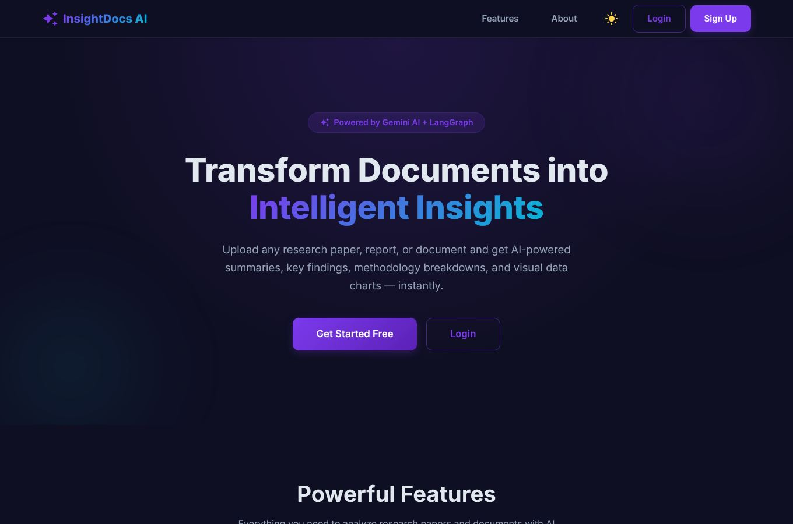
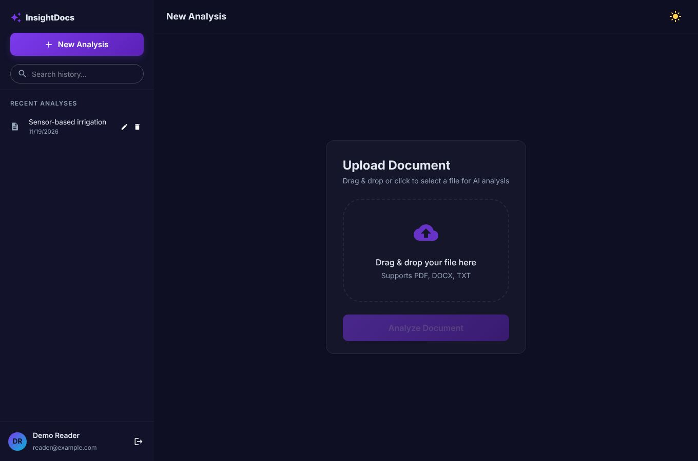
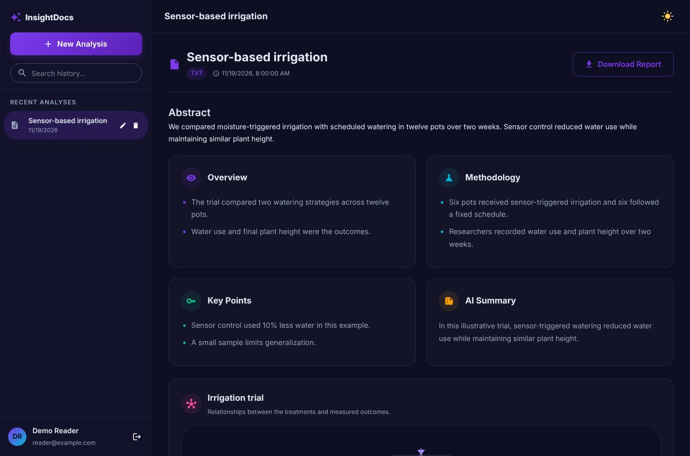
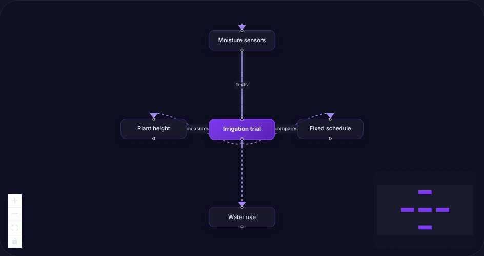

# InsightDocs AI — Research Paper Simplifier

Upload a research paper and read its overview, methodology, key points, and AI summary in one workspace. An interactive knowledge graph shows how the paper’s concepts relate to each other.

**[Open the live demo](https://ai-research-paper-simplifier-v02.vercel.app/)** · [GitHub repository](https://github.com/niteshkumar-11n/AI-Research-Paper-Simplifier_V02)



## Try it

1. Create an account or sign in, then open **New Analysis**.
2. Drop a text-based PDF, DOCX, or TXT file into the upload area and select **Analyze Document**.
3. Read the analysis, explore the graph, or use **Download Report** to save a text copy.
4. Use the sidebar to search, reopen, rename, or delete a saved analysis.



## What the results contain

| Section | What it shows |
| --- | --- |
| Abstract | The live demo extracts the paper’s labeled abstract when it can identify one. |
| Overview | A short introduction to the topic and scope. |
| Methodology | Bullet points describing the methods in the supplied text. |
| Key points | Findings and takeaways from the analyzed passages. |
| AI summary | A short synthesis of the document content. |
| Knowledge graph | Labeled nodes for entities and concepts, with edges describing relationships. Pan, zoom, or use the minimap to explore. |

The screenshots below show the application interface with an illustrative irrigation study loaded for documentation.





## How analysis works

FastAPI receives the upload and extracts text with PyPDF2, python-docx, or UTF-8 decoding. A LangGraph workflow cleans and chunks the text, requests the structured analysis, then makes a second model call for the graph. MongoDB stores each result with its owner and timestamp. The React dashboard renders the sections and builds the downloadable TXT report.

PDFs need selectable text. Scanned pages require OCR before upload. The current workflow uses the first five overlapping chunks for analysis and the first three for the graph, so later sections of long papers may fall outside the model input.

## Project layout

| Path | Responsibility |
| --- | --- |
| `frontend/src/pages/` | React pages for home, signup, login, and the dashboard |
| `frontend/src/components/` | Material UI upload and history controls, results, and React Flow graph |
| `backend/routes/` | FastAPI endpoints for accounts, uploads, and saved analyses |
| `backend/services/document_service.py` | Document text extraction |
| `backend/agents/analysis_agent.py` | LangChain model calls and the LangGraph analysis workflow |
| `vercel.json` | Static frontend build, Python function, and request routing |

## Run locally

Use Node.js 22, Python 3.12, a MongoDB Atlas database, and a Gemini API key. Allow your development machine to connect to the database.

```bash
git clone https://github.com/niteshkumar-11n/AI-Research-Paper-Simplifier_V02.git
cd AI-Research-Paper-Simplifier_V02/backend
python -m venv .venv
```

Activate the environment with `source .venv/bin/activate` on macOS/Linux or `.venv\Scripts\Activate.ps1` in Windows PowerShell. Install the backend dependencies.

```bash
python -m pip install -r requirements.txt
```

Create `backend/.env` with your own values. Generate a signing secret with `python -c "import secrets; print(secrets.token_urlsafe(48))"`.

```dotenv
MONGO_URI=mongodb+srv://<username>:<password>@<cluster-host>/
JWT_SECRET=<generated-signing-secret>
GEMINI_API_KEY=<gemini-api-key>
```

**Model compatibility.** The hosted demo uses a configurable Gemini model and includes abstract extraction. The reviewed GitHub revision (`7e691e4`) hard-codes `gemini-2.5-flash-lite` in `backend/agents/analysis_agent.py`. If you clone that revision, select a model available to your Gemini project in the `ChatGoogleGenerativeAI` constructor. The verified demo used `gemini-3.5-flash-lite`. Setting `GEMINI_MODEL` takes effect only in revisions that read that variable.

Start the API from `backend/`.

```bash
python -m uvicorn main:app --reload
```

In a second terminal, start the frontend from the repository root.

```bash
cd frontend
npm ci
npm run dev
```

Open [the local app](http://localhost:5173). Vite proxies `/api` requests to FastAPI on port 8000. Explore the routes in the [local API documentation](http://localhost:8000/docs).

## Vercel deployment

Use the repository root as the Vercel project directory so the frontend and backend build together. Set `MONGO_URI`, `JWT_SECRET`, and `GEMINI_API_KEY` as server-side environment variables for the target environment, then deploy. Keep private keys out of `VITE_*` variables and version control.

To verify a deployment, upload a short document using **New Analysis**. Check that the overview, methodology, key points, and graph appear, then reopen the result from history. If only a source excerpt appears, inspect the runtime logs for `/api/upload/analyze` for provider authentication or model availability errors. Existing history entries retain the results originally saved.
